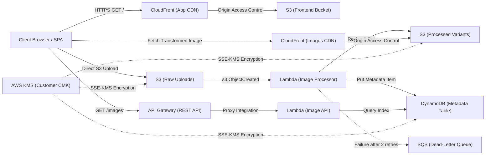
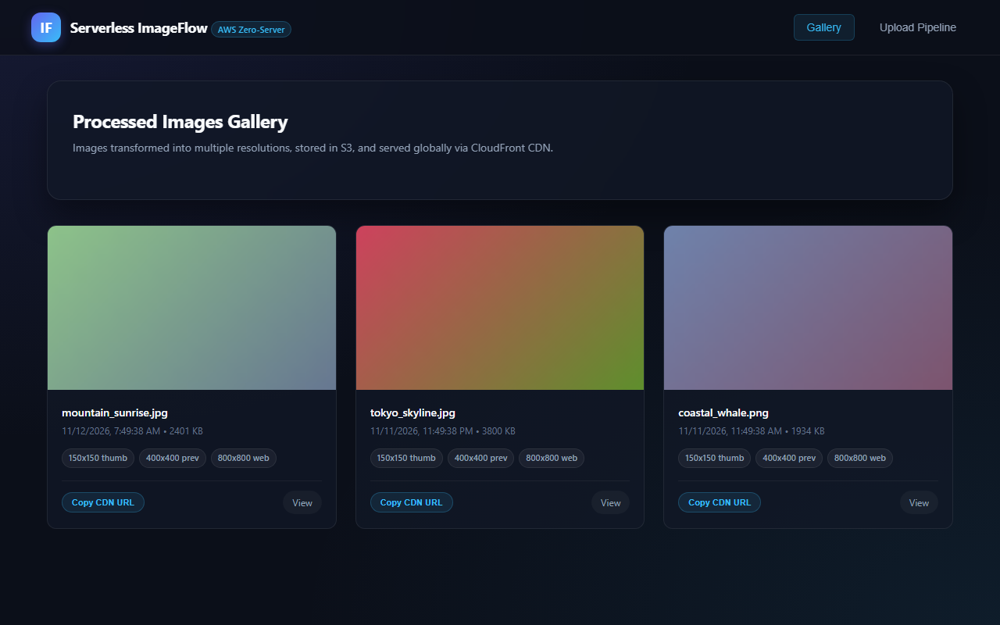

# AWS Serverless ImageFlow

Serverless image processing pipeline on AWS: upload, transform, and serve via CDN with zero server management.

## Why this project exists

This project serves as the event-driven serverless counterpart to cloudmart-devops-project, which deployed containerized microservices onto AWS EKS with ArgoCD. While CloudMart demonstrated Kubernetes cluster operations, container networking, and GitOps, Serverless ImageFlow demonstrates how to solve data transformation problems using fully managed AWS services with zero server maintenance. Together, both repositories prove architectural judgment: knowing when to run containers on Kubernetes versus when to execute asynchronous event-driven code on AWS Lambda.

[](https://github.com/modimihir07/aws-serverless-imageflow/actions/workflows/ci.yml)


## Architecture

The active deployed stack consists strictly of production-verified, locally testable services. Aspirational and decorative components have been moved out of the active path to ensure architectural integrity.



### Monospace Architecture Diagram (80-Column Terminal Width)

```
[ Client Browser / Modern Single Page Application ]
       |                                    ^
  (HTTPS Upload)                       (HTTPS Fetch)
       |                                    |
       v                                    |
[ S3 Raw Uploads ]                     [ CloudFront Images CDN ]
       |                                    ^
 (s3:ObjectCreated)                         | (Origin Access Control)
       v                                    |
[ Lambda: Image Processor ] ---------> [ S3 Processed Variants ]
       |            |                       ^
 (Metadata Write) (On Failure: 2 Retries)   |
       v            v                       |
[ DynamoDB Table ] [ SQS DLQ ]              |
       ^                                    |
  (Query / Read)                            |
       |                                    |
[ Lambda: Image API ] <--- [ API Gateway ] -+
       ^
       |
[ Client Browser: Query Metadata via REST API ]

* Storage & DB encrypted at rest with AWS Customer-Managed Key (KMS CMK)
```

## What this proves

This project demonstrates core serverless architectural competencies distinct from container operations:

- **Serverless vs Containers:** Designing systems where compute units spin up on demand and bill exclusively during execution, contrasting with pre-provisioned EC2 worker nodes on EKS.
- **Event-Driven vs Request-Response:** Triggering compute asynchronously from object storage state changes rather than holding open synchronous HTTP client connections.
- **NoSQL Single-Table Design vs Relational Models:** Using Amazon DynamoDB with a Global Secondary Index (GSI) for partition-key lookups and status filtering, rather than AWS RDS PostgreSQL.
- **Least-Privilege Security Boundaries:** Scoping every IAM role down to specific resource ARNs, enforcing TLS (`aws:SecureTransport`), CloudFront Origin Access Control (OAC), and client-side safe DOM manipulation.
- **Cost Discipline:** Structuring a cloud application that costs $1.02/month when idle instead of paying continuous fixed infrastructure costs for control planes and cluster nodes.

## Preview the UI locally

You can run the web user interface locally without an AWS account or cloud credentials. The built-in mock server serves the glassmorphic SPA and simulates API Gateway and S3 endpoints.

Run the mock server:

```bash
node frontend/mock-server.js
```

Open `http://localhost:3000` in your browser.



## Verify locally

The codebase is locally verifiable without AWS credentials. Every command below runs directly against source files and exits cleanly:

### 1. Pytest Unit Tests and Coverage
```bash
pytest lambda/image-processor lambda/image-api -v --cov=lambda/image-processor --cov=lambda/image-api
```
Expected output:
```
======================== 22 passed, 6 warnings in 4.85s ========================
TOTAL coverage: 98%
```

### 2. Terraform Code Formatting
```bash
terraform fmt -check -recursive terraform/
```
Expected output: Exits 0 with no formatting diff.

### 3. Terraform Configuration Validation
```bash
cd terraform/live/dev && terraform init -backend=false && terraform validate
```
Expected output:
```
Success! The configuration is valid.
```

### 4. Static Infrastructure Security Scans
```bash
tfsec terraform/
```
Expected output:
```
critical: 0, high: 0, medium: 0, low: 0
No problems detected!
```

```bash
checkov -d terraform/ --framework terraform --hard-fail-on HIGH,CRITICAL --quiet --compact
```
Expected output: Exits 0 with zero HIGH or CRITICAL findings.

### 5. Automated Secret Detection
```bash
gitleaks detect --source . --verbose --no-git
```
Expected output:
```
INF scan completed
INF no leaks found
```

## Project Status

This repository is code-complete and locally verified. It has not yet been deployed to a live AWS account.

What this means for a reader:
- All source code, Terraform modules, and Lambda handlers are present and validated
- CI pipeline runs green on GitHub runners without AWS credentials
- Full deployment instructions are in DEPLOY.md

What is verified locally:
- Pytest suite passes with 22 tests and 98% code coverage
- Terraform fmt and validate pass with zero syntax or configuration errors
- tfsec and Checkov report zero HIGH or CRITICAL security findings
- Gitleaks detects zero hardcoded secrets or credentials
- CI runs green on GitHub Actions without AWS secrets
- Local UI preview works via mock server (screenshot linked above)

What has not been run:
- terraform apply against a real AWS account
- Live Lambda invocations against real S3 events
- CloudFront propagation and end-to-end thumbnail generation

If you are evaluating this as a portfolio piece: the value is in the architecture, the code quality, and the deployment instructions. If you want to run it yourself, DEPLOY.md takes you from clone to a working deployment in approximately 20 minutes on a fresh AWS account.

## How to deploy

See [DEPLOY.md](DEPLOY.md) for exact commands from clone to working deployment.

## Scope

### Implemented and locally verified
- AWS Lambda functions: `image-processor` (Pillow image transformations, blurhash calculation, S3 event handling, idempotency checks) and `image-api` (Powertools REST resolver, query pagination, health check).
- Amazon S3 configuration: 4 buckets with Block Public Access, TLS enforcement, SSE-KMS encryption, and version lifecycle policies.
- Amazon DynamoDB: Metadata table with Global Secondary Index (`status-upload_date-index`) and point-in-time recovery.
- Amazon CloudFront: Frontend distribution and image delivery distribution with Origin Access Control (OAC) and strict security response headers.
- Amazon API Gateway: REST API definition with request validators, stages, and CloudWatch execution logging.
- Amazon SQS: Dead-letter queue attached to async Lambda invocation configuration.
- AWS KMS: Customer-managed key with key rotation policy.
- Automated testing: Unit tests, flake8 linting, black formatting, Bandit SAST, and Checkov/tfsec scanning.

### Ready-to-deploy but not yet run
- Full Terraform live orchestration (`terraform/live/dev` and `terraform/live/prod`).
- Live S3 bucket notification trigger to Lambda function.
- CloudFront edge caching across worldwide points of presence.

### Deliberately out of scope
- AWS WAFv2: Documented in `terraform/future/waf/`; excluded from active path to avoid $10.00/month idle fees on prototype environments.
- Amazon Cognito: Documented in `terraform/future/cognito/`; excluded from active path to eliminate unresolvable hosted login domains during local testing.
- AWS Step Functions: Documented in `terraform/future/step-functions/`; excluded because direct S3-to-Lambda event notification provides lower latency and avoids unnecessary state transition complexity.
- Route53 and ACM: Documented future work; avoids external domain registration costs.
- EventBridge custom bus: Cut from active path because the application does not emit custom event bus events.

## Cost

Estimated deployment costs based on AWS US-East-1 pricing:

- **Estimated Monthly Idle Cost (24/7 with zero traffic):** **$1.02/month**  
  Breakdown: AWS KMS Customer-Managed Key ($1.00/month), Amazon S3 minimal metadata storage (~$0.02/month). Lambda, DynamoDB, API Gateway, CloudFront, and SQS incur $0.00 while idle within the AWS Free Tier.
- **Estimated 1-Hour Live Demo Cost:** **$0.02**  
  Breakdown: Running the complete stack for 1 hour with 50 uploads, 150 variant transformations, and 200 API queries before running `terraform destroy`.

*Note: These figures are engineering estimates based on published AWS pricing.*

## Security summary

Security is implemented across 6 architectural layers, including strict IAM resource scoping, mandatory S3 TLS enforcement, customer-managed KMS encryption, and client-side XSS defenses using pure DOM APIs. For line-by-line verification and the post-build audit findings, see [docs/SECURITY-AUDIT.md](docs/SECURITY-AUDIT.md).

---

Author and Architecture Lead: Mihir Modi
